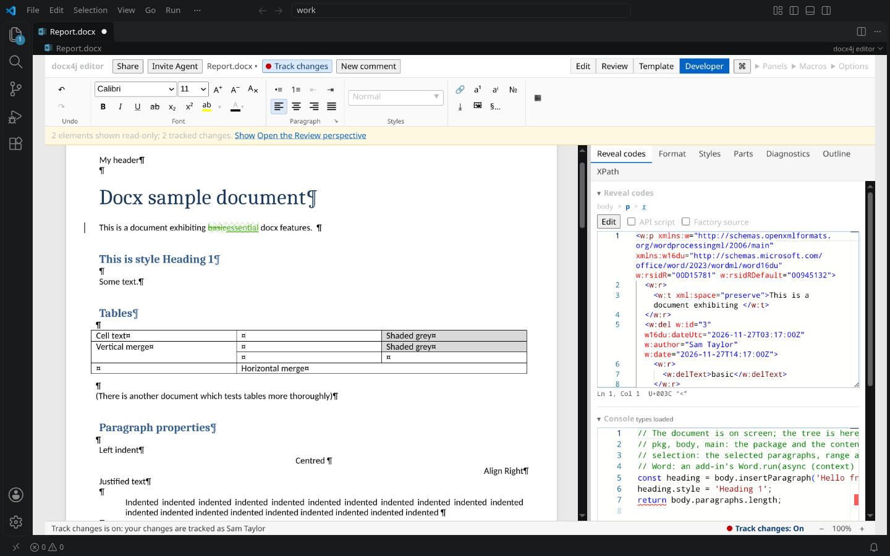

# docx4j editor for VS Code

Edit Word documents (`.docx`, `.dotx`, `.docm`, `.dotm`) in VS Code, with their XML in view. Tracked changes and comments
are written as Word writes them, so a document edited here opens in Word with its changes intact, and the other way round.



The extension is in preview.

## What it offers

- **The XML in view,** in VS Code's own editor: reveal codes beside the document, where the XML of the paragraph or
  table at the caret, in the body, a note or a header, can be edited and applied; the package's other parts (styles,
  numbering, settings, custom XML) editable as XML; and an XPath console.
- **Content controls and OpenDoPE templates:** controls made, bound to their data and previewed, in a Template
  perspective.
- **An agent as a reviewer.** Once you invite it, an agent such as Claude Code edits the document beside you, and every
  edit it makes is a tracked change under its own name, for you to accept or reject.
- **Review:** tracked changes, a review panel, and comments in the margin.
- **Open end to end:** the editor is GPL, over an Apache-2.0 engine, [docx4j-core-ts](https://github.com/plutext/docx4j-core-ts).

## Getting started

- **A Word file** opens in the editor, unless you have chosen another editor for it.
- **New Word Document** (File → New File…, or the command palette) opens an untitled document. Its first Save asks where to
  save it.
- **A Markdown file:** choose Open With… → "docx4j editor (Markdown as a Word document)". It opens as a new, untitled Word
  document. Saving writes a `.docx`, never the `.md`.

## The default editor

The editor is the default for the four Word types. To use another editor for one file, choose Open With… on it. To change
the default, choose Open With… → "Configure default editor for '*.docx'…", or set `workbench.editorAssociations` in your
settings:

```json
"workbench.editorAssociations": { "*.docx": "default" }
```

When another installed extension also claims `.docx`, VS Code asks which editor to use.

## Saving

- **Save** is VS Code's. The editor first checks that what it writes reads back as the document it showed, and refuses the
  save otherwise.
- **A file another program changed** since it was read is not written over: Save fails, and the banner offers Reload.
- **Auto save** works. On a large document it holds the editor for a few seconds at each pause while the file is written.
- **Hot exit:** unsaved edits survive closing VS Code and starting it again. After a crash, VS Code brings each document
  back as its record of open editors found it, which it writes every minute: edits made to a document since that record
  may be lost.

## Where it differs from VS Code's text editors

- **Edit → Undo and Redo do nothing** in this editor. Use Ctrl+Z and Ctrl+Shift+Z (Cmd on a Mac), or the toolbar.
- **Save As** writes the new file, then opens it afresh, with the caret where it was. The undo history starts again.
  - **In VS Code before 1.147,** and in editors built on it, VS Code then asks "Do you want to save the changes you made to
    …?" about the old file as it closes its editor. **Answer Don't Save:** the edits are in the new file already.
  - **Keys typed just after Save As's dialog closes,** while the new file is being written, may be lost.
- **A rename or a move** reopens the document with its unsaved edits, and its undo history starts again.
- **Not offered here:** printing, downloading, Send a copy, the phone layout, and the browser's recovery of unsaved
  documents (hot exit does that in VS Code).

## The keys

In the document, Word's keys are the editor's, and VS Code's other keys are VS Code's.
- **The editor's in the document:** Ctrl+B, Ctrl+I, Ctrl+U, Ctrl+E, Ctrl+R, Ctrl+J, Ctrl+K (Insert Link), Ctrl+M, Ctrl+Q,
  Ctrl+Shift+E (Track Changes) and the rest. VS Code's bindings on those keys (Toggle Side Bar, Quick Open, Toggle Panel,
  Quit, Show Explorer) work from outside the document: the tab, the explorer, the terminal.
- **The Ctrl+K chords** do not start from the document, since Ctrl+K is Insert Link there. They work from outside it.
- **VS Code's own keys work from the document:** Ctrl+S, Ctrl+P, Ctrl+Shift+P, F1, Ctrl+W, Ctrl+Tab.
- **"docx4j editor: Commands"** (Ctrl+Alt+P, ⌥⌘P on a Mac) opens the editor's own command palette.
- **Cut, Copy and Paste** work from the keys and the context menu. VS Code's Edit menu does not reach the editor.
- **Paste as plain text:** Ctrl+Shift+V, or Paste as Plain Text in the document's context menu.
- **In the console and the XML panes,** the keys are those of VS Code's own editor: F1 is its palette there.
- **In a field of a panel,** Ctrl+K starts VS Code's chords, as in any webview.
- **No spelling is checked:** VS Code's windows have no spell checker.

## The agent

In a trusted local window:
- **Invite Agent** in the editor starts the agent's companion, shares the document into it and invites the agent. Every
  edit the agent makes is a tracked change under its name, for you to accept or reject. **Stop** in People ends it.
- **"docx4j editor: Copy the Agent's MCP Address"** copies the companion's MCP address for Claude Code or any MCP client,
  and offers Claude Code's command, `claude mcp add …`. That command puts its token in `~/.claude.json` and in your
  shell's history, in plain text.
- **VS Code's own agent mode** finds the companion as an MCP server once you have used Invite or the address command in the
  workspace. VS Code's MCP view can disable it.
- **Share** puts the document in a room. Its link works on this computer only: it opens the editor the companion serves,
  in a browser beside VS Code. **"docx4j editor: Join a Room…"** opens a room's link in an editor of its own.
- **The agent's name** is the setting `docx4j.agent.name` ("Agent"), taken at the companion's next start.
- **The companion** stops with the window, and uses about 150 MB while it runs. After VS Code starts again, a document that
  was in a room joins it again, and the agent comes back when you invite it again.
- **If Claude Code is refused** (403) after VS Code's copy of the token changed, copy the Claude Code command again.

## The Ask box

The Developer perspective's Ask box sends a question about the document to a model. Nothing changes in the document until
you press a button, and a script it answers with lands in the console unrun.
- **VS Code's models:** the box lists the language models VS Code offers (GitHub Copilot's, or one you gave VS Code a key
  for) and sends through the one you choose. They take no system prompt, so the request goes as one message. VS Code may
  ask your consent first, and the Accounts menu's trusted extensions withdraw it; a model you gave VS Code your own key for
  asks none.
- **Your Anthropic API key:** "docx4j editor: Set the Anthropic API Key…" keeps it in VS Code's secret storage, for every
  window. The extension sends with it, and the editor's page never holds it. "docx4j editor: Remove the Anthropic API Key"
  removes it.
- **The key's address** is the setting `docx4j.ask.baseUrl`, Anthropic's own when empty. Only your user settings in the
  Default profile hold it, never a workspace's, and it travels with Settings Sync; the key does not.
- **A chat:** copy the request into a Claude chat and paste the answer back.
- **Other extensions** share VS Code's extension host with this one, so an extension you install could see the key's
  request.

## Trust and where it runs

- **Restricted Mode:** documents open and can be edited, but a document's macros are not offered, and the agent's
  companion is not started, so there is no Invite and no Share. After you trust the workspace, close and reopen a document
  to have them.
- **A local window.** In a remote window (SSH, WSL, a dev container) the companion is not started. vscode.dev and
  github.dev are not supported.
- **VS Code 1.105 or later,** and the editors built on it.
- **Checked on Linux,** not yet on Windows or macOS.

## Privacy

Nothing leaves your computer but:
- an Ask request, when you send one: to the model you chose, or to the key's address;
- a document you share into a room on a relay elsewhere, or a room you join there;
- a link in a document, when you follow it.

The extension collects no telemetry. The companion listens on this computer only.

## Languages

The editor follows VS Code's display language, or the one you choose in its Options. Its words in nineteen languages
beside English are drafts, not yet reviewed by native speakers.

## More

- [Reviewing documents](https://github.com/plutext/docx4j-editor/blob/main/docs/user/review.md): tracked changes,
  comments and the agent.
- [The Developer perspective](https://github.com/plutext/docx4j-editor/blob/main/docs/user/developer-perspective.md),
  and [its Ask box](https://github.com/plutext/docx4j-editor/blob/main/docs/user/Help_AskBox.md).
- [Sharing a document](https://github.com/plutext/docx4j-editor/blob/main/docs/user/co-editing.md).
- [Issues](https://github.com/plutext/docx4j-editor/issues).

## Licence

GPL-3.0-or-later, with a commercial licence available from Plutext. The third-party notices are in the extension's
`THIRD-PARTY-NOTICES.txt`, and in its `app/` and `companion/` folders.
